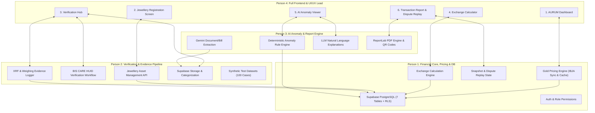

# AURUM — Architecture & 4-Person Team Workload Division
**Project Directory**: `D:\RVCE\Sem 3\Tech4Bharat`  
**Target Platform**: AURUM (Customer-Facing Gold Verification & Exchange Transparency Platform)  
**Supplementary Reference**: LoanGuard AI System Architecture  

---

## 1. Executive Summary & Team Allocation

The application architecture is structured into a modular design separating physical verification, financial calculations, AI-assisted discrepancy analysis, and customer-facing UI. 

The workload is split across **4 team members**:
- **3 Backend & Feature Engineers** (Person 1, Person 2, Person 3)
- **1 Frontend & UI/UX Lead** (Person 4)



---

## 2. Team Workload Division Matrix

| Member | Role Title | Core Focus | Key Technologies |
| :--- | :--- | :--- | :--- |
| **Person 1** | **Financial Engine, Pricing & Database Architect** | Valuation math, IBJA rate ingestion, Supabase DB schema, RLS, transaction snapshotting | PostgreSQL, Supabase, Python / Node.js, IBJA Data |
| **Person 2** | **Verification, Evidence Pipeline & Data Management** | Asset lifecycle, BIS HUID validation, XRF/weight logging, media storage, 100-case dataset | Supabase Storage, REST APIs, BIS Verification, Datasets |
| **Person 3** | **AI Intelligence, Anomaly Engine & PDF Generator** | Document OCR, rule-based discrepancy detector, LLM risk explanations, ReportLab PDF & QR | Gemini API, Python / ReportLab, Rule Engine, QR Codes |
| **Person 4** | **Frontend & UI/UX Lead** | Next.js App Router, Tailwind CSS, shadcn/ui components, 6 core screens, API integration | Next.js 15, React 19, Tailwind CSS, shadcn/ui |

---

## 3. Detailed Person-by-Person Breakdown (AURUM)

### Person 1: Financial Engine, Pricing & Database Architect (Backend)
> **Goal**: Own the deterministic financial calculations, benchmark price ingestion, database schema, and transaction snapshotting.

#### Core Modules & Responsibilities:
1. **Supabase Database & Authentication**:
   - Create migrations for the **7 core tables**:
     - `users`: `id`, `name`, `role` (customer, jeweller, admin), `phone`, `created_at`
     - `jewellery`: `id`, `owner_id`, `type`, `gross_weight`, `purity`, `created_at`
     - `verifications`: `id`, `jewellery_id`, `HUID`, `xrf_result`, `net_weight`, `stone_weight`, `verified_by`, `status`
     - `gold_rates`: `id`, `date`, `purity` (24K, 22K, 18K, 14K), `rate`, `source` (IBJA), `session` (AM/PM), `timestamp`
     - `transactions`: `id`, `customer_id`, `jeweller_id`, `jewellery_id`, `snapshot_rate`, `snapshot_purity`, `deductions_breakdown`, `final_offer`, `status`
     - `evidence`: `id`, `transaction_id`, `file_url`, `evidence_type`, `timestamp`
     - `anomaly_flags`: `id`, `transaction_id`, `flag_type`, `severity`, `explanation`, `created_at`
   - Implement **Row-Level Security (RLS)**:
     - Customers can view and access only their own transactions.
     - Jewellers access only transactions assigned to their store.
2. **Gold Pricing Engine**:
   - Implement daily Indian gold benchmark price collector (IBJA):
     - Rates for 999 (24K), 995, 916 (22K), 750 (18K), and 585 (14K).
     - Track morning (AM) and evening (PM) rate sessions.
   - Cache rates with fallback handling for weekends and market holidays.
3. **Core Exchange Valuation Engine**:
   - Implement pure gold equivalent formula:
     $$\text{Pure Gold (g)} = W_n \times \frac{P}{999}$$
   - Valuation formula:
     $$V = W_n \times R_{999} \times \frac{P}{999}$$
     *(Where $W_n$ = Net gold weight, $R_{999}$ = 24K benchmark rate, $P$ = Measured fineness)*
   - Deduction breakdown engine ($D$):
     - Itemized melting/refining charges, stone deductions, and handling.
     - Final net offer: $V_{\text{offer}} = V - D$.
4. **Transaction Snapshotting (Dispute Replay)**:
   - Freeze all calculation inputs (rate, purity, weight, deduction items, calculation version) upon transaction confirmation so future rate changes never mutate past transactions.
5. **API Endpoints Delivered**:
   - `GET /api/gold-rates/latest`
   - `GET /api/gold-rates/history`
   - `POST /api/calculator/evaluate`
   - `POST /api/transactions/create`
   - `GET /api/transactions/:id/snapshot`

---

### Person 2: Verification, Evidence Pipeline & Data Management (Backend)
> **Goal**: Own the physical verification pipeline, hallmark/HUID validation, file storage architecture, and synthetic test datasets.

#### Core Modules & Responsibilities:
1. **Jewellery Asset Registration API**:
   - CRUD operations for customer jewellery records (metal type, declared purity, approximate weight, photos, customer notes).
2. **Hallmark & BIS HUID Verification Workflow**:
   - 6-character alphanumeric HUID validation.
   - BIS CARE verification pipeline:
     - Record official declared purity, jewellery category, assaying & hallmarking centre (AHC), and verification timestamp.
     - Comparison logic: flag differences between customer-declared attributes and BIS records.
3. **Physical & Instrument Verification Logger**:
   - XRF analyzer measurement logger (purity / fineness percentage).
   - High-precision weighing scale inputs:
     - Gross weight, stone weight, and calculated net gold weight.
   - Evidence categorization layer (strictly tagging data as: *Officially Verified*, *Instrument-Recorded*, *Jeweller-Entered*, or *Customer-Provided*).
4. **Evidence Media Pipeline**:
   - Supabase Storage bucket configuration with access permissions.
   - Secure upload handlers for jewellery photos, physical weigh-scale readout images, and XRF certificates.
5. **Synthetic Prototype Dataset Generation**:
   - Generate and seed 100 benchmark testing records:
     - **50 normal records**: Clean, consistent transactions.
     - **20 incomplete records**: Missing XRF reports or missing receipts.
     - **20 inconsistent records**: Weight discrepancies, deduction mismatches.
     - **10 hallmark mismatch records**: Declared 22K vs measured 18K, invalid HUIDs.
6. **API Endpoints Delivered**:
   - `POST /api/jewellery/register`
   - `GET /api/jewellery/:id`
   - `POST /api/verification/huid-check`
   - `POST /api/verification/physical-record`
   - `POST /api/evidence/upload`

---

### Person 3: AI Intelligence, Anomaly Engine & PDF Generator (Backend & AI)
> **Goal**: Own document extraction, the deterministic anomaly rule engine, LLM risk explanations, and PDF report generation.

#### Core Modules & Responsibilities:
1. **AI Document & Receipt OCR (Gemini API)**:
   - Multimodal prompt pipeline using Gemini to parse uploaded purchase bills, tax invoices, and old appraisal certificates into structured JSON:
     - Fields extracted: Date of purchase, jeweller name, gross weight, net weight, purity/karat, invoice amount.
2. **Deterministic Anomaly & Inconsistency Engine**:
   - Rule-based evaluation (code-driven, not hallucinated by LLM):
     - Purity mismatch (e.g. customer claims 22K, XRF measures 750/18K).
     - Weight variance (scale weight differs from declared weight beyond tolerance).
     - Hallmark mismatch (HUID registered article type differs from presented item).
     - Incomplete evidence (missing XRF photo or scale receipt).
     - Stale gold price (pricing date does not match transaction date).
     - Disproportionate deductions (unexplained deduction spikes).
3. **LLM Risk Explanations (Gemini API)**:
   - Convert flagged technical discrepancies into plain-language, neutral explanations for customers and jewellers.
   - Generate summary risk scores (Low, Medium, High) with recommended remediation steps.
4. **PDF Report Engine (ReportLab / PDFKit)**:
   - Generate customer-facing, downloadable official transaction certificates containing:
     - Unique Transaction ID & timestamp.
     - Customer and jeweller verified details.
     - Itemized valuation math (gross metal value, itemized deductions, net offer).
     - High-resolution thumbnails of verified evidence photos.
     - Embedded QR Code (via `qrcode` library) linking to the immutable transaction record.
5. **API Endpoints Delivered**:
   - `POST /api/ai/extract-bill`
   - `POST /api/ai/detect-anomalies`
   - `POST /api/ai/explain-risk`
   - `GET /api/reports/:transaction_id/download-pdf`

---

### Person 4: Frontend Lead & UI/UX Engineer (Full Frontend)
> **Goal**: Build the complete responsive Next.js 15 client application, design system, and integrate with backend APIs.

#### Core Modules & Responsibilities:
1. **Design System & Foundation**:
   - Next.js 15 App Router + React 19 + Tailwind CSS + shadcn/ui.
   - Gold & dark-slate luxury theme appropriate for jewellery valuation.
   - Role switcher / layout shells for **Customer**, **Jeweller**, and **Admin**.
2. **Implementation of the 6 Core Screens**:
   - **Screen 1 — AURUM Dashboard**:
     - Live IBJA gold rate ticker (24K, 22K, 18K with AM/PM badges).
     - Recent transaction table with status pills (*Verified*, *Pending*, *Flagged*).
     - Quick action buttons: "New Jewellery Evaluation", "Verify HUID", "Exchange Calculator".
   - **Screen 2 — Jewellery Registration**:
     - Multi-step form with React Hook Form and Zod client validation.
     - Drag-and-drop image upload with instant client preview.
     - Field inputs: Jewellery category, declared karat, approximate weight.
   - **Screen 3 — Verification Centre**:
     - Interactive HUID lookup interface with BIS verification badges.
     - Side-by-side comparison card: Customer declared vs Jeweller recorded vs BIS official record.
     - XRF machine input form and scale readout logger with evidence tag indicators.
   - **Screen 4 — Exchange Calculator**:
     - Dynamic real-time calculation widget.
     - Interactive sliders for itemized deductions (refining charge %, stone weight deductions) updating the live offer in real time.
   - **Screen 5 — AI Anomaly & Inconsistency Review**:
     - Color-coded severity banners (Green: Verified, Amber: Attention Required, Red: Discrepancy Found).
     - AI summary drawer displaying Gemini's plain-language explanation of detected mismatches.
   - **Screen 6 — Transaction Report & Dispute Replay**:
     - Web preview of the final transaction certificate with embedded QR code.
     - One-click "Download PDF" action trigger.
     - Historical dispute replay view comparing original snapshot data against current market value.
3. **Client API Integration**:
   - Connect all forms, tables, and buttons to endpoints created by Person 1, Person 2, and Person 3.

---

## 4. Alternative Reference Mapping: LoanGuard AI Architecture

If working on the **LoanGuard AI** architecture shown in the uploaded diagram:

```mermaid
flowchart LR
    P4_LG["Person 4: Frontend Lead<br/>- Next.js 15 + React 19 (14 Pages)<br/>- shadcn/ui + Tailwind CSS<br/>- Audio Alert Player & Dashboards"]
    
    P1_LG["Person 1: Middle Tier & Data Platform<br/>- FastAPI Backend (Cloud Run)<br/>- BigQuery (29 Tables, loanguard_data)<br/>- FRED Macro API<br/>- Climatiq Carbon API"]
    
    P2_LG["Person 2: Predictive ML Models<br/>- Breach Predictor (LightGBM)<br/>- % LGD Estimator (LightGBM)<br/>- Prepayment Risk (XGBoost)<br/>- ESG Scorer (XGBoost)"]
    
    P3_LG["Person 3: Multi-Agent AI & Integrations<br/>- Gemini 2.5 Flash (5-Agent Committee)<br/>- Affinda AI (Document Parsing)<br/>- ElevenLabs (Voice Alerts)<br/>- SendGrid & Google Search"]

    P4_LG <-->|REST API (127 Endpoints)| P1_LG
    P1_LG <--> P2_LG
    P1_LG <--> P3_LG
```

| Member | LoanGuard AI Responsibilities | Scope & Key Components |
| :--- | :--- | :--- |
| **Person 1** | **Backend Service & BigQuery Data Platform** | FastAPI orchestration (Google Cloud Run), BigQuery dataset management (`loanguard_data`, 29 tables), SQL pipeline, FRED macroeconomic data ingestion, Climatiq carbon calculation engine. |
| **Person 2** | **Predictive ML Modeling & Risk Analytics** | Build and serve 4 ML models: LightGBM (Breach Predictor, % LGD Estimator) + XGBoost (Prepayment Risk, ESG Scorer), feature pipelines, model inference APIs. |
| **Person 3** | **Multi-Agent AI & External Integrations** | Gemini 2.5 Flash 5-Agent Risk Committee orchestration, Affinda AI document extraction, ElevenLabs voice alert synthesis, SendGrid email notification delivery, Google Custom Search for greenwashing detection. |
| **Person 4** | **Frontend Engineering (UI Lead)** | Next.js 15 + React 19 (14 pages), shadcn/ui components, loan underwriting dashboards, risk committee decision views, ESG metrics charts, audio alert player, Vercel deployment. |

---

## 5. 3-Week Execution Roadmap

```mermaid
gantt
    title AURUM 3-Week Implementation Timeline
    dateFormat  YYYY-MM-DD
    section Week 1: Foundations
    P1: Supabase Setup, 7 Tables, RLS, Auth       :w1p1, 2026-11-20, 7d
    P2: Jewellery API & Storage Buckets           :w1p2, 2026-11-20, 7d
    P3: Gemini Setup & Bill Extraction OCR        :w1p3, 2026-11-20, 7d
    P4: UI Skeleton, Styling, Registration Form   :w1p4, 2026-11-20, 7d
    section Week 2: Core Workflows
    P1: IBJA Rates Sync & Calculation Engine      :w2p1, after w1p1, 7d
    P2: HUID Verification & XRF Logger            :w2p2, after w1p2, 7d
    P3: Anomaly Rule Engine & PDF Generator       :w2p3, after w1p3, 7d
    P4: Calculator Screen & Verification Hub UI   :w2p4, after w1p4, 7d
    section Week 3: Integration & Polish
    P1: Snapshot Engine & Dispute Replay State    :w3p1, after w2p1, 7d
    P2: 100-Record Synthetic Dataset & Seeding    :w3p2, after w2p2, 7d
    P3: LLM Explanations & QR Code Stamping       :w3p3, after w2p3, 7d
    P4: AI Review UI, PDF Viewer & Vercel Deploy  :w3p4, after w2p4, 7d
```

---

## 6. Definition of Done for MVP Demonstration

For the hackathon demo, the team must execute one complete, end-to-end golden flow:
1. **Customer Submits**: Customer enters jewellery details and uploads an old bill/photo (Person 4 UI + Person 2 API + Person 3 OCR).
2. **Jeweller Verifies**: Jeweller logs XRF purity result and scale weight (Person 4 UI + Person 2 API).
3. **HUID Validation**: System compares entered HUID against BIS benchmark data (Person 2 API).
4. **Live Valuation**: System applies IBJA daily rate and computes transparent deductions (Person 1 Engine).
5. **AI Inconsistency Check**: Rule engine flags discrepancies (e.g. declared 22K vs measured 18K), and Gemini explains them (Person 3 AI).
6. **Certificate Generated**: Both parties view the transparent breakdown and download an official PDF report with a verification QR code (Person 3 PDF + Person 4 UI).
